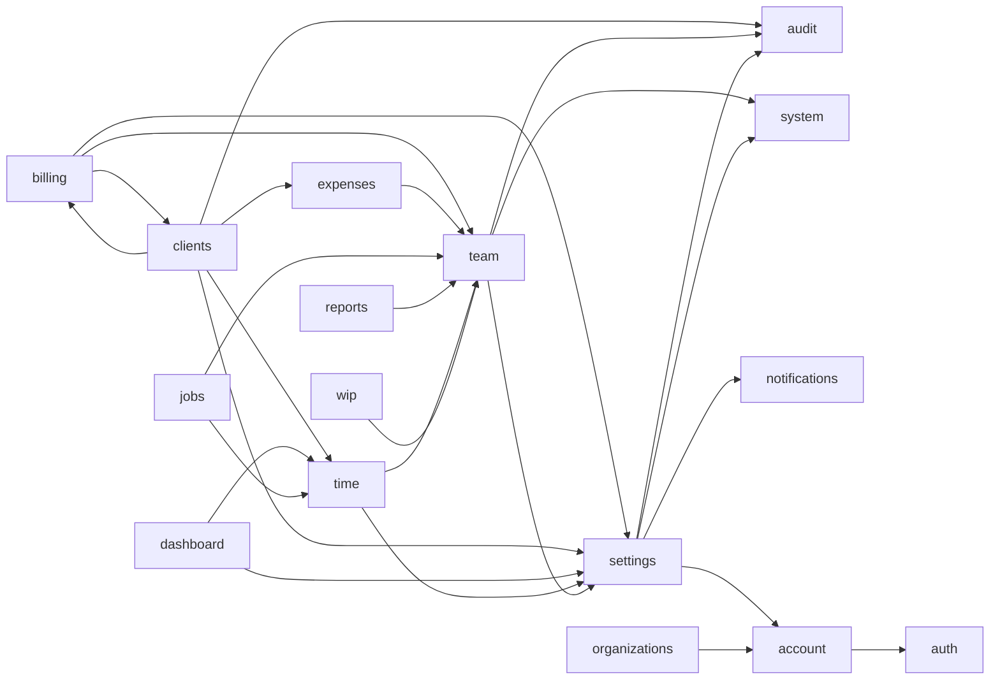

# Module map

This document has one section per folder in `src/features`. Each section lists:

- the module's routes and pages, below `/:orgSlug`;
- its main components;
- the API endpoints it calls;
- the shared components it relies on;
- the other features it imports.

**Where the data comes from:**

- **Routes and access rules:** `src/constants/navigation.ts`, `src/app/router/pageLoaders.ts` and
  `routes.tsx`.
- **Endpoints:** read from each feature's `api/` files. Unless shown otherwise, paths are relative
  to `/api/v1/organizations/{organizationId}`. `{}` is an id.
- **Imports:** a scan of `import … from '@/features/<x>'` in non-test files.

For what each endpoint does, see the API repo: `../capiumtimenfeeapi/docs/modules/<module>.md`.
For the patterns and components named here, see [ui-standards.md](ui-standards.md).

## Cross-feature dependencies

Every practice feature imports `organizations` (`useOrg`). Most import `useAuth` from `auth`.
Both are left out of the diagram. An arrow `A --> B` means A imports B's `index.ts`.

**What crosses each boundary:**

- `team` provides the shared pickers (`ClientPicker`, `JobPicker`, `StaffPicker`) and catalogue
  hooks (`useServices`, `useActivityTypes`, `useVatCodes`).
- `settings` provides the toggles and lookups (`useBranchesEnabled`, `useSegmentsEnabled`,
  `useRoles`, `useInvoiceTemplates`, `useBeforeUnload`, `useOnboarding`).
- `billing` and `clients` import each other:
  - `clients` uses `PrepareInvoicePanel`, to create an invoice from the client's Invoices tab.
  - `billing` uses `clients`' `ClientPicker`.
- **Pages loaded across modules** (router only): Reports → Time Analysis loads
  `time/pages/TimeAnalysisPage`, and Settings → Services loads `team/pages/ServicesPage`.
- **No `index.ts`:** `jobs`, `reports`, `wip` and `help`. No other feature imports them.

## Practice modules

### dashboard

- **Routes.** `dashboard/` with `overview`, `my-actions`, `my-timesheet`, `pending-approvals`,
  `missing-timesheets`, `top-clients-by-wip`, `billing-trend` and `debtor-ageing`. The module is
  open to any member. Each page has its own rule, for example `pending-approvals` needs
  `timesheet.approve` or `expense.approve`.
- **Pages.** `Dashboard*Page.tsx`, plus `DashboardLayoutPage` (the sidebar).
- **Components.**
  - Widgets: `Widget`, `WidgetStates`, `SummaryCards`, `MyActionsWidget`, `PendingApprovalsWidget`.
  - Charts: `BillingTrendChart`, `DebtorAgeingChart`, `TopClientsChart`, `MyTimesheetChart`.
  - Other: `GettingStartedCard` (which keeps its own localStorage flag).
- **Endpoints.**
  - `dashboard/{cards,my-actions,my-timesheet,pending-approvals,missing-timesheets,top-clients-by-wip,billing-trend,debtor-ageing}`
  - `timesheets/{}/approve`, `expense-claims/{}/approve`, `timesheets/reminders/run`
- **Shared components.** `components/charts`, `Table` (the dashboard pages), `Tabs`, `Card`,
  `EmptyState`.
- **Imports.** `time` (`ZeroRateWarning`), `settings` (`useOnboarding`).

### clients (see [design/client-360.md](design/client-360.md) and [design/clients-page.md](design/clients-page.md))

- **Routes.** All need `client.read`. Clients has no sidebar: the Client List and Leads both
  carry the same Clients | Leads tabs (`components/ClientsLeadsSwitch`), so Leads never hides
  Clients (7 Nov 2026).
  - `clients/` is the list (`ClientsPage`).
  - `clients/360` is the landing page (`Client360Page`).
  - `clients/leads` is `LeadsPage`.
  - `clients/:clientId/*` is the workspace (`ClientDetailPage`). Its tabs are overview, jobs, time,
    expenses, wip, invoices, payments, recovery, contacts, history and settings. Each tab has its
    own permission (`workspace/constants.ts`).
- **Components:**
  - `components/` for the list: `ClientsTable`, `ClientsGrid`, `ClientsToolbar`, `FilterPanel`,
    `FilterSetMenu`, `ColumnsMenu`, `ActionMenu`, `BulkActionsMenu`, `ClientFormPanel`,
    `ImportDialog`, `AnalyticsPanel`.
  - `workspace/` for the header, tabs, overview, records and settings cards.
  - `central/` for the Capium Central dialog and chip.
  - `leads/` (`LeadFormPanel`).
  - `picker/ClientPicker.tsx` (exported).
- **Endpoints.**
  - `clients` (list, `summary`, `bulk`, `export`, `central-sync`), `clients/{}` (`archive`,
    `overview`, `contacts[/{}]`, `services[/{}][/create-job|/job-runs]`, `rates[/{}]`,
    `job-rates`, `recovery`, `wip`, `statement/pdf`, `central-link`, `central-sync`)
  - `central-clients[/{}/enable]`, `leads[/summary|/{}|/{}/archive|/unarchive|/convert]`,
    `imports/clients`
  - Reads for the workspace tabs: `jobs`, `time-entries`, `disbursements`, `invoices`,
    `credit-notes`, `payments`, `members`, `services`, `vat-rates`, `invoice-templates`,
    `rates/{}`
- **Shared components.**
  - The list: mostly its own `cc-*` CSS (`styles/capium-clients.css`), plus `RowActions`,
    `BulkBar` and `ConfirmDialog`.
  - The workspace and Leads: `DataTable`, `CountTabs`, `FormPanel`, `Badge`.
- **Persisted state.** `store.ts` (`capium-clients`, version 2) and `recents.ts`.
- **Imports.** `billing` (`PrepareInvoicePanel`), `time` (`EntryPanel`, `useEntryActions`),
  `expenses` (`DisbursementFormPanel`, `useDeleteDisbursement`), `settings` (branches, segments,
  `useBeforeUnload`), `audit` (`RecordHistory`), `auth`.

### time

- **Routes.**
  - `time/` is My Timesheet (`time.log`).
  - `entries` needs `time.log` or `time.read_all`.
  - `team` needs `time.read_all` or `timesheet.approve`.
  - `approvals` needs `timesheet.approve`, and is an approval page.
  - `analysis` needs `report.read` or `time.read_all`.
  - The old `time/timer` path redirects to `time`.
- **Pages.** `MyTimesheetPage`, `TimeEntriesPage`, `TeamTimesheetsPage`, `TimesheetApprovalsPage`,
  `TimeAnalysisPage`, plus `TimeLayoutPage`.
- **Components.**
  - `timesheet/`: `WeekView`, `WeekGridTable`, `DayView`, `CalendarView`, `TimerCard`,
    `CopyWeekDialog`.
  - `EntryPanel`, `HistoryDrawer` (a `Sheet`), `team/PersonSheetDrawer` (a `Sheet`).
  - `approvals/`, `analysis/` (`ExportMenu`, `UtilisationCard`), `Notice`, `ReasonDialog`.
- **Endpoints.**
  - `time-entries` (`/week`, `/day`, `/calendar`, `/copy-week`), `time-entries/{}` (`/copy`,
    `/correct`, `/history`, `/remove`)
  - `timer` (`/start`, `/pause`, `/resume`, `/stop`)
  - `timesheets`, `timesheets/missing`, `timesheets/reminders/run`, `timesheets/{}` (`/submit`,
    `/approve`, `/reject`, `/recall`, `/reopen`)
  - `approvals[/bulk-approve]`, `staff`, `reports/time-summary`, `reports/utilisation`
- **Shared components.** `DataTable`, `Table` (approvals), `Sheet`, `DurationInput`,
  `SegmentedControl`, `RowActions`.
- **Imports.** `team` (pickers, `useServices`, `useActivityTypes`), `settings` (`useOnboarding`),
  `auth`.

### jobs

- **Routes.** All need `job.read`: `jobs/` (list), `details`, `budgets`, `tasks`, `assignments`,
  `calendar` and `jobs/:jobId` (`JobDetailPage`).
- **Pages.** `JobsPage`, `JobDetailsPage`, `JobDetailPage`, `BudgetTrackingPage`, `TasksPage`,
  `AssignmentsPage`, `JobCalendarPage`, plus `JobsLayoutPage`.
- **Components.**
  - `JobFormPanel`, `TaskFormPanel`, `TasksPanel`, `BudgetPanel` (a `Table`).
  - `JobsBulkBar` and `TasksBulkBar` (the shared `BulkBar`).
  - `AssigneePicker` (`OptionPicker`), `StatusPickers`, `StatusBadges`, `CopyJobDialog`.
- **Endpoints.**
  - `jobs` (`/bulk`, `/budgets`, `/calendar`), `jobs/{}` (`/status`, `/assignees`, `/copy`,
    `/budget`, `/budget/evaluate`)
  - `jobs/{}/tasks` (`/bulk`, `/from-service`, `/{}`, `/{}/status`, `/{}/assignees`)
  - `tasks[/bulk]`, `members`
- **Shared components.** `DataTable`, `PageToolbar`, `CountTabs`, `BulkBar`, `FormPanel`,
  `OptionPicker`, `ConfirmDialog`.
- **Imports.** `team` (pickers, `useServices`, `useServiceTaskTemplates`), `time` (`JobTimeCard`),
  `auth`.

### expenses

- **Routes.**
  - `expenses/` is Expense Claims (`expense.read_all` or `expense.manage`).
  - `mine` needs `expense.log`.
  - `approvals` needs `expense.approve`, and is an approval page.
  - `receipts`, `disbursements` and `types` have their own rules.
  - Claim details open at `mine/:claimId`, `claims/:claimId` or `approvals/:claimId`
    (`ExpenseClaimDetailPage`).
- **Components.**
  - `NewClaimPanel`, `LineFormPanel`, `LinesTable`, `ReviewLines`, `DecisionDialogs`.
  - `receipts/` (`ReceiptsDialog`, `ReceiptPreview`).
  - `DisbursementFormPanel` (exported), `ExpenseTypeFormPanel`, `ClaimHistory`, `StatusBadge`.
- **Endpoints.**
  - `expense-claims` (`/summary`, `/{}`, `/{}/lines[/{}]`, `/{}/submit|approve|return|recall`)
  - `expense-approvals[/bulk-approve]`
  - `expenses/{}/receipts[/{}]`, `expense-receipts`
  - `expense-types[/{}]`, `disbursements[/{}]`, `clients/{}`, `jobs/{}`
- **Shared components.** `DataTable`, `Table` (approvals), `FormPanel`, `Modal`, `ConfirmDialog`,
  `RowActions`.
- **Imports.** `team` (pickers, `useVatCodes`), `auth`.
- **Exports.** `BILLING_STATUS_META` and `CLAIM_STATUS_META`.

### wip (see [design/wip.md](design/wip.md))

- **Routes.** All need `wip.read`: `wip/` (summary), `details`, `ageing`, `adjustments`,
  `transfers` and `historic`. The old `billing/wip` path redirects here.
- **Components.**
  - `SummaryView`, `AdjustmentsView`, `WriteOffsView`, `LedgerView`.
  - `TransferDialog`, `AdjustmentFormPanel`, `WriteOffDialog`, `ReasonDialog` (wraps
    `ConfirmDialog`).
  - `ExportMenu`, `WipFilterFields`, and the `*Columns.tsx` column definitions.
- **Endpoints.**
  - `wip/{summary,items,ledger}`
  - `wip/adjustments[/counts|/{}/approve|reject|reverse]`, `wip/transfers[/{}/reverse]`,
    `wip/write-offs[/{}]`
  - `reports/wip[/items]`, `members`
- **Shared components.** `DataTable`, `SegmentedControl` (Adjustments, Write-offs, Ledger),
  `Popover`, `RowActions`.
- **Imports.** `team` (`ClientPicker`, `JobPicker`, `useServices`).

### billing

- **Routes.**
  - `billing/prepare` (Create Invoice) needs `invoice.create`.
  - `invoices` and `credit-notes` need `invoice.read`.
  - `recurring` needs `recurring.read`.
  - `estimates` needs `estimate.read`.
  - `payments` needs `payment.read`.
  - `debtors` and `statements` need `payment.read` or `invoice.read`.
  - `invoices/:invoiceId` is `InvoiceDetailPage`.
- **Components.**
  - `prepare/` (`PrepareInvoicePanel`, exported), `invoice/` (detail cards and lines),
    `invoices/`, `creditNotes/`, `payments/`, `debtors/`, `statements/`, `estimates/`,
    `recurring/`, `documents/`.
  - `LineGrid`, `AllocationGrid`, `IssueDialog`, `SendInvoiceDialog`, `RecordPaymentPanel`,
    `ReasonDialog`, `badges.tsx`.
- **Endpoints.**
  - `invoices` (`/bulk`, `/summary`), `invoices/{}` (`/lines`, `/issue`, `/submit`, `/approve`,
    `/reject`, `/send`, `/void`, `/pdf`, `/credit-notes`)
  - `credit-notes[/{}][/pdf|/wip]`
  - `payments[/{}][/allocations[/{}]|/reverse|/void]`
  - `debtors`, `debtors/reminders`, `debtors/{}/invoices`, `statements`
  - `clients/{}/{billing-summary,wip,statement,statement/pdf,statement/send}`
  - `estimates` (`/summary`, `/{}`, `/{}/send|accept|decline|convert`), `recurring`
    (`/{}`, `/{}/pause|resume|runs`, `/runs/{}/retry`)
  - `services`, `vat-rates`
- **Shared components.** `DataTable`, `PageToolbar`, `CountTabs`, `RowActions`, `ConfirmDialog`,
  `Modal`, `FormPanel`, `Dropdown` (invoice detail), `SegmentedControl` (debtors).
- **Imports.** `clients` (`ClientPicker`), `team` (`ClientPicker`, `StaffPicker`), `settings`
  (`useInvoiceTemplates`, `useBeforeUnload`).

### reports

- **Routes.**
  - `reports/time-analysis` (loads `time/pages/TimeAnalysisPage`), `utilisation` and
    `missing-timesheets` need `report.read`.
  - `expenses` needs `report.read` or `report.financial`.
  - `job-profitability`, `wip-ageing`, `recovery`, `recovery-analysis`, `cost-to-business`,
    `billing`, `payments`, `aged-debtors` and `vat-summary` need `report.financial`.
  - `staff-cost` needs `report.staff_cost` (APT81). Downloads need `report.export`.
- **Components.** `ReportScreen` (a generic screen driven by `definitions/*.tsx`), `ReportFilters`,
  `FilterPopover`, `ExportMenu`, `StatCards`.
- **Endpoints.** `reports/{endpoint}`: JSON, and a blob for exports (`api/reportsApi.ts`).
- **Shared components.** `DataTable`, `components/charts`, `Popover`.
- **Imports.** `team` (pickers, `useActivityTypes`, `useServices`).

### team (see [design/team-rates.md](design/team-rates.md))

- **Routes.**
  - `team/staff` and `grades` need `member.read`.
  - `cost-rates`, `charge-out-rates`, `rate-history` and `rate-preview` need `rate.read`.
  - `re-rate` needs `rate.manage`.
  - `overtime-rates` needs `rate.read`; changing them needs `rate.manage` (APT81).
  - `activity-types` has the module rule.
  - `staff/:staffId` is `StaffDetailPage`.
  - The old `team/services` path redirects to `settings/services`, which still loads
    `team/pages/ServicesPage`.
- **Components.**
  - `staff/`: the bulk bar, the deactivate, delete and link-login dialogs,
    `StaffPermissionsCard` (a `Sheet`).
  - `grades/`, `rates/` (`RateLadder` is a `Table`; also `RateRulesView`), `rerate/`
    (`RunsHistory`, `ApplyDialog`).
  - `catalogue/` (services, activity types).
  - `pickers/` (`ClientPicker`, `JobPicker`, `StaffPicker`, `LookupCombobox`), all exported.
- **Endpoints.**
  - `staff` (`/bulk`, `/{}`, `/{}/deactivate|reactivate|invite|link-login|unlink-login`),
    `members/{}` (`/permissions`, `/reset-password`)
  - `grades[/{}]`
  - `rates` (`/history`, `/impact`, `/resolve`, `/rerate`, `/rerate/preview`, `/reruns`,
    `/reruns/{}/items`, `/{}`)
  - `services[/{}][/activity-codes|/task-templates]`, `activity-codes[/{}]`
  - `clients`, `jobs`, `vat-rates`
- **Shared components.** `DataTable`, `RowActions`, `FormPanel`, `ConfirmDialog`, `BulkBar`,
  `Sheet`.
- **Imports.** `settings` (roles, permissions, segments), `audit` (`RecordHistory`), `system`
  (`useRoleName`), `auth`.

### settings (see [design/settings-billing.md](design/settings-billing.md) and [design/notifications.md](design/notifications.md))

- **Routes.**
  - The module rule is any of `settings.manage`, `organization.update`, `organization.read`,
    `role.read` or `audit_log.read`.
  - Pages: `general`, `practice`, `roles`, `period-lock`, `branches`, `segments`, `services`
    (from team), `vat-codes`, `document-numbering`, `invoice-templates`, `notifications`,
    `email-templates`, `integrations`, `import-export`, `audit-logs`, `onboarding`.
- **Components.** One folder per page: `general/`, `practice/`, `roles/` (`RoleEditor`,
  `PermissionPicker`, `DeleteRoleDialog`), `periodLock/`, `branches/`, `segments/`, `vat/`,
  `numbering/`, `templates/`, `integrations/`, `importExport/`, `onboarding/`, `audit/`. Also a
  local `ConfirmDialog`, `LoadError` and `MemberPicker`.
- **Endpoints.**
  - The practice: `PATCH /organizations/{}`, `roles[/{}][/permissions]`, `members[/{}]`,
    `GET /permissions` (global)
  - `period-locks[/calendar|/history|/reopen|/settings]`, `branches[/{}]`, `segments[/{}]`,
    `staff/{}/segments`
  - `vat-rates[/{}]`, `sequences[/{}]`, `invoice-templates[/{}][/make-default|/watermark-image]`
  - `integrations[/{}][/sync|/retry-failed|/mock/availability]`,
    `integrations/{sync-items[/{}/retry],sync-logs,bookkeeping/mappings}`
  - `imports/{clients,jobs,staff,rates,opening_balance_time}`,
    `{clients,jobs,staff,rates}/export`
  - `onboarding[/steps/{}]`, `audit-logs`
- **Shared components.** `DataTable`, `Switch`, `Tabs` (import/export, integrations),
  `ConfirmDialog` and the local fork, `MemberPicker`.
- **Imports.** `notifications` (`NotificationSettingsView`, `EmailTemplatesView`), `account`
  (avatar, time zones), `audit`, `system`.
- **Exports.** Toggles and lookups that other features use.

## Account, platform and support features

| Feature         | Routes                                                                                                                        | Main parts                                                                                                                                                                                      | Endpoints                                                                                                                       | Imports                |
| --------------- | ----------------------------------------------------------------------------------------------------------------------------- | ----------------------------------------------------------------------------------------------------------------------------------------------------------------------------------------------- | ------------------------------------------------------------------------------------------------------------------------------- | ---------------------- |
| `account`       | `/:orgSlug/account` (`AccountPage`)                                                                                           | `ProfileForm`, `ProfilePicture`, `ChangePasswordForm`, `SessionsList`, `LogoutEverywhere`                                                                                                       | `/users/me`, `/users/me/{avatar,password,sessions[/{}]}` (not under organizations)                                              | `auth`                 |
| `auth`          | `/login`, `/register`, `/forgot-password`, `/reset-password`, `/verify-email`, `/change-password` (pages in `src/pages/auth`) | `AuthProvider`, guards, `LoginForm`, `RegisterForm`, `ResetPasswordForm`, `PasswordStrength`                                                                                                    | `/auth/{login,logout,logout-all,refresh,register,forgot-password,reset-password,verify-email,resend-verification}`, `/users/me` | none                   |
| `organizations` | Wraps `/:orgSlug` (`OrgRoute`), `/onboarding`                                                                                 | `OrgProvider`, `useOrg`, `Can`, `CreateOrganizationForm`, `DeleteOrganization`, `ApprovalOffNotice`                                                                                             | `/organizations`, `/organizations/by-slug/{slug}`, `/organizations/{}`, `/users/me/organizations`                               | `account` (time zones) |
| `system`        | none (deployment mode)                                                                                                        | `OpenDeploymentOnly`, `useSystemInfo`, `useRoleName`                                                                                                                                            | `/system`                                                                                                                       | none                   |
| `audit`         | none. The Audit Logs page is `settings/pages/AuditLogSettingsPage`                                                            | `ChangesTable`, `RecordHistory`, `ExportMenu`                                                                                                                                                   | `audit-logs/history`, `audit-logs/export`                                                                                       | none                   |
| `notifications` | none. The views are rendered by `settings/notifications` and `settings/email-templates`; the bell is in the shell             | `useNotificationsShell`, `settings/` (`ChannelMatrix`), `templates/` (`TemplateEditor`)                                                                                                         | `notifications[/unread-count                                                                                                    | /read-all              | /{}/read]`, `notification-settings[/practice]`, `email-templates[/{}][/preview]` | none |
| `tickets`       | `application-testing/{dashboard,tickets,tickets/:ticketId}`, needs `ticket.read`                                              | `list/` (`TicketsTable`, `TicketsToolbar`, `CreateTicketPanel`, local `BulkBar`), `detail/` (`CommentComposer`, `TimelinePanel`, `AttachmentPreview`), `dashboard/`, `SelectPill`, `TagPopover` | `tickets` (`/bulk`, `/dashboard`, `/{}`, `/{}/attachments[/{}]`, `/{}/comments`, `/{}/timeline`), `ticket-tags`                 | `auth`                 |
| `help`          | `/:orgSlug/help` (`HelpPage`)                                                                                                 | `HowItWorksTab`, `FlowDiagram`, `GlossaryTab`, `ShortcutsTab`, `SupportTab`                                                                                                                     | none                                                                                                                            | none                   |
